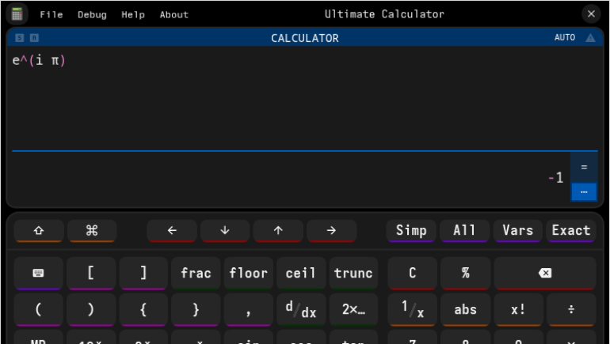

<div align="center">

<h1>Ultimate Calculator</h1>
<p><strong>An Electron-based scientific calculator for arithmetic, algebra, and everything in between.</strong></p>
</div>

> [!WARNING]
> The app is still in development

[](./LICENSE)

Ultimate Calculator is a desktop calculator built on [Electron](https://www.electronjs.org/) and [mathjs](https://mathjs.org/). It combines a keyboard-first calculator interface with a full computer-algebra engine: evaluate expressions, simplify to exact fractions, switch between number bases, inspect variables, and look up mathjs functions without leaving the app.

## Features

### Calculation

- **Expression input** with live syntax highlighting for parentheses, operators, functions, strings, and comments.
- **Keyboard-first workflow** — press <kbd>Enter</kbd> to evaluate, <kbd>Shift</kbd>+<kbd>Enter</kbd> for a new line.
- **SHIFT / ALPHA keys** expose the alternate function of every calculator button, just like a physical scientific calculator.
- **mathjs engine** for arithmetic, algebra, trigonometry, units, matrices, complex numbers, fractions, and BigNumbers.
- **`Simp`** simplifies the current expression symbolically; **`Exact`** keeps the result as an exact expression instead of a decimal.
- **Number modes** — BigNumber or native JavaScript numbers, with configurable precision.
- **Complex modes** — rectangular (`a + bi`) or polar (`r ∠ θ`).
- **Angle modes** — degrees, radians, or gradians.
- **Result notation** — automatic, fixed, scientific, engineering, binary, octal, or hexadecimal. Cycle it with <kbd>Ctrl</kbd>+<kbd>Alt</kbd>+<kbd>B</kbd> or choose it in Preferences.
- **Thousands and thousandths separators** — comma, quote, space, or none.
- **Live preview** — optionally evaluate while you type.

### Discovery and variables

- **All menu** — searchable list of every mathjs function and constant, with descriptions.
- **Vars menu** — inspect and autocomplete the current parser scope; variables you define stay available for later expressions.
- **Function help windows** — mathjs documentation for a function, including syntax, description, examples, and related entries.
- **Array result window** — large array results can be expanded in a dedicated window.
- **`ans`** always holds the last evaluated result.

### Desktop and customization

- **Preferences window** for fonts, accent color, JavaScript syntax theme, font size, reduced motion, button colors, separators, precision, live preview, and history size.
- **Persistent state** — settings and history are stored in `localStorage` under the `ultimate-calculator` namespace, compressed with gzip.
- **Custom title bar** with minimize, maximize, close, and always-on-top controls.
- **Minimal mode** (<kbd>Ctrl</kbd>+<kbd>Space</kbd>) collapses the window to just the display.
- **Zoom controls** and a **debug overlay** with FPS, window size, uptime, and runtime versions.
- **CLI utilities** for inspecting the Node.js/Electron environment (see below).

## Tech stack

| Layer | Technology |
| --- | --- |
| Desktop shell | Electron `^45.2.2` |
| Math engine | mathjs `^15.2.0` |
| UI | Plain HTML, CSS, and ES modules (no bundler) |
| Syntax highlighting | highlight.js (bundled) |
| Icons | Material Design Icons (bundled webfont) |
| Packaging | `@electron/packager` and `electron-builder` |
| Persistence | `localStorage` + `CompressionStream('gzip')` |

Renderer files are served directly from `public/`; there is no build step for the UI.

## Requirements

- **Node.js 20 or newer** (developed against Node 24) and npm.
- **Linux, Windows, or macOS.**
- A desktop session — Electron needs a display server to open a window. On Linux, both X11 and Wayland are supported; always-on-top may not work under some Wayland compositors.

## Getting started

```sh
git clone git@github.com:PhantomusBiscuit/ultimate-calculator.git
cd ultimate-calculator
npm install
npm start
```

Or use the included launcher, which changes into the repository directory before starting Electron:

```sh
./start
./start clear   # clear the terminal first
./start help    # shows help
```

> [!NOTE]
> `npm install` downloads the Electron binary, so the first install can take a while.

## npm scripts

| Script | What it does |
| --- | --- |
| `npm start` | Run the app with Electron. |
| `npm run package:linux` | Package a Linux x64 build into `dist/linux`. |
| `npm run package:win32` | Package a Windows x64 build into `dist/win32`. |
| `npm run package:darwin` | Package a macOS x64 build into `dist/darwin`. |
| `npm run package:all` | Package all three platforms into `dist/all`. |

The packaging scripts use `@electron/packager`. An `electron-builder` configuration also lives in the `build` section of `package.json` (AppImage/deb for Linux, NSIS/portable for Windows, dmg for macOS), for example:

```sh
npx electron-builder --linux
npx electron-builder --win
npx electron-builder --mac
```

## CLI flags

`main.js` handles a few inspection flags before creating the Electron window. Pass them through the launcher:

```sh
./start --help
./start --version
./start --builtin-modules -1
./start --system
```

| Flag | Description |
| --- | --- |
| `-h`, `--help` | Print usage and examples. |
| `--version` | Print Node.js, Electron, Chromium, V8, and related runtime versions. |
| `--builtin-modules` | List Node.js built-in modules. |
| `-1` | With `--builtin-modules`, print one module per line. |
| `--system` | Print platform, window manager (X11/Wayland), Linux distribution, kernel, and desktop environment. |

## The `uc://` protocol

All app windows load through a custom privileged protocol instead of `file://`. It is registered as standard, secure, and CORS/fetch capable, and the app registers itself as the default protocol client for `uc`.

| URL | Resolves to |
| --- | --- |
| `uc://public/index.html` | `public/index.html` |
| `uc://public/settings.html` | `public/settings.html` |
| `uc://local/preload.js` | `preload.js` (project root) |
| `uc://libs/mathjs.js` | `public/libs/mathjs.js` |

The main window opens `uc://public/index.html` by default. Unknown hosts return a 404.

## Keyboard shortcuts

On macOS, use <kbd>Cmd</kbd> where <kbd>Ctrl</kbd> is listed.

### Calculator and app

| Shortcut | Action |
| --- | --- |
| <kbd>Enter</kbd> | Evaluate the expression. |
| <kbd>Shift</kbd>+<kbd>Enter</kbd> | Insert a new line. |
| <kbd>Ctrl</kbd>+<kbd>Shift</kbd>+<kbd>S</kbd> | Toggle the SHIFT key. |
| <kbd>Ctrl</kbd>+<kbd>Shift</kbd>+<kbd>A</kbd> | Toggle the ALPHA key. |
| <kbd>Ctrl</kbd>+<kbd>Alt</kbd>+<kbd>C</kbd> | Open the constants/function menu. |
| <kbd>Ctrl</kbd>+<kbd>Alt</kbd>+<kbd>S</kbd> | Open the variables/scope menu. |
| <kbd>Ctrl</kbd>+<kbd>Alt</kbd>+<kbd>B</kbd> | Cycle the result notation. |
| <kbd>Ctrl</kbd>+<kbd>Shift</kbd>+<kbd>I</kbd> | Focus the input. |
| <kbd>Ctrl</kbd>+<kbd>Space</kbd> | Toggle minimal mode. |
| <kbd>Alt</kbd>+<kbd>0</kbd> | Open the application menu. |
| <kbd>Alt</kbd>+<kbd>1</kbd>…<kbd>4</kbd> | Open a specific application menu. |
| <kbd>Esc</kbd> | Close open menus. |
| <kbd>F10</kbd> | Toggle the debug overlay. |
| <kbd>Shift</kbd>+<kbd>F10</kbd> | Copy debug information to the clipboard. |

### Electron

| Shortcut | Action |
| --- | --- |
| <kbd>Ctrl</kbd>+<kbd>,</kbd> | Open Preferences. |
| <kbd>Ctrl</kbd>+<kbd>=</kbd> / <kbd>Ctrl</kbd>+<kbd>-</kbd> / <kbd>Ctrl</kbd>+<kbd>0</kbd> | Zoom in / out / reset. |
| <kbd>Ctrl</kbd>+<kbd>R</kbd> | Reload. |
| <kbd>Ctrl</kbd>+<kbd>Shift</kbd>+<kbd>R</kbd> | Force reload. |
| <kbd>F12</kbd> | Toggle DevTools. |
| <kbd>Ctrl</kbd>+<kbd>Q</kbd> | Quit. |

## Project structure

```text
.
├── main.js                    Electron main process: windows, menus, IPC, protocol, CLI flags
├── preload.js                 contextBridge API (`uc`, `fs`) and console wrapper
├── public/
│   ├── index.html             Main calculator window
│   ├── script.js              Calculator buttons, menus, input handling, shortcuts
│   ├── settings.html          Preferences window
│   ├── help.html              mathjs function help window
│   ├── function-preview.html  Function source preview window
│   ├── manual.html            Manual window (placeholder)
│   ├── show-array.html        Expanded array result window
│   ├── assets/                Styles, themes, icons, manual data, hero image
│   ├── fonts/                 Noto Sans and Material Design Icons fonts
│   └── libs/
│       ├── module.js          Core UI helpers, Settings, CalcDisplay, formatting
│       ├── math-import.js     mathjs bootstrap (`window.mathjs`, `window.math`)
│       ├── mathjs.js          Bundled mathjs build
│       ├── highlight.js       Syntax highlighter
│       └── nerdamer/          Bundled nerdamer files
├── start                      POSIX launcher (`npm start` passthrough)
├── jsconfig.json              Editor configuration for cross-file globals and mathjs types
├── package.json               Scripts, dependencies, electron-builder config
└── package-lock.json
```

### How the pieces fit

1. `main.js` starts Electron, registers the `uc://` protocol, builds the native menus, and creates the main window.
2. `preload.js` exposes a small, sandboxed API to the renderer (`uc.*`) and injects the console timestamp wrapper.
3. `public/index.html` loads `math-import.js`, `module.js`, and `script.js` as ES modules.
4. `module.js` owns settings, compressed storage, result formatting, and the calculator display.
5. `script.js` wires the keypad, menus, autocomplete, and global shortcuts to that core.

## Data and persistence

- Settings and history use `localStorage` keys prefixed with `ultimate-calculator:`.
- Values are gzip-compressed before being stored and decompressed on read.
- History size is configurable in Preferences (`History → Max entries`, default `100`).
- Removing the app's site data (or clearing `localStorage`) resets settings and history.

## Notes

- The **Manual** window is currently a placeholder; mathjs documentation is available from the **Help** menu and the **All** menu.
- History is recorded and `ans` is updated after each evaluation, but there is no full history browser yet.
- The version shown in the **About** menu is hard-coded and may lag behind `package.json`.

## License

Released under the **PolyForm Noncommercial 1.0.0**:
<fieldset>
<legend>License</legend>
<span>
<h1 id="polyform-noncommercial-license-100">PolyForm Noncommercial License 1.0.0</h1>
<p><a href="https://polyformproject.org/licenses/noncommercial/1.0.0" rel="noopener noreferrer" target="_blank">https://polyformproject.org/licenses/noncommercial/1.0.0</a></p>
<h2 id="acceptance">Acceptance</h2>
<p>In order to get any license under these terms, you must agree
to them as both strict obligations and conditions to all
your licenses.</p>
<h2 id="copyright-license">Copyright License</h2>
<p>The licensor grants you a copyright license for the
software to do everything you might do with the software
that would otherwise infringe the licensor's copyright
in it for any permitted purpose.  However, you may
only distribute the software according to <a href="#distribution-license">Distribution
License</a> and make changes or new works
based on the software according to <a href="#changes-and-new-works-license">Changes and New Works
License</a>.</p>
<h2 id="distribution-license">Distribution License</h2>
<p>The licensor grants you an additional copyright license
to distribute copies of the software.  Your license
to distribute covers distributing the software with
changes and new works permitted by <a href="#changes-and-new-works-license">Changes and New Works
License</a>.</p>
<h2 id="notices">Notices</h2>
<p>You must ensure that anyone who gets a copy of any part of
the software from you also gets a copy of these terms or the
URL for them above, as well as copies of any plain-text lines
beginning with <code>Required Notice:</code> that the licensor provided
with the software.  For example:</p>
<blockquote>
  <p>Required Notice: Copyright Yoyodyne, Inc. (<a href="http://example.com" rel="noopener noreferrer" target="_blank">http://example.com</a>)</p>
</blockquote>
<h2 id="changes-and-new-works-license">Changes and New Works License</h2>
<p>The licensor grants you an additional copyright license to
make changes and new works based on the software for any
permitted purpose.</p>
<h2 id="patent-license">Patent License</h2>
<p>The licensor grants you a patent license for the software that
covers patent claims the licensor can license, or becomes able
to license, that you would infringe by using the software.</p>
<h2 id="noncommercial-purposes">Noncommercial Purposes</h2>
<p>Any noncommercial purpose is a permitted purpose.</p>
<h2 id="personal-uses">Personal Uses</h2>
<p>Personal use for research, experiment, and testing for
the benefit of public knowledge, personal study, private
entertainment, hobby projects, amateur pursuits, or religious
observance, without any anticipated commercial application,
is use for a permitted purpose.</p>
<h2 id="noncommercial-organizations">Noncommercial Organizations</h2>
<p>Use by any charitable organization, educational institution,
public research organization, public safety or health
organization, environmental protection organization,
or government institution is use for a permitted purpose
regardless of the source of funding or obligations resulting
from the funding.</p>
<h2 id="fair-use">Fair Use</h2>
<p>You may have "fair use" rights for the software under the
law. These terms do not limit them.</p>
<h2 id="no-other-rights">No Other Rights</h2>
<p>These terms do not allow you to sublicense or transfer any of
your licenses to anyone else, or prevent the licensor from
granting licenses to anyone else.  These terms do not imply
any other licenses.</p>
<h2 id="patent-defense">Patent Defense</h2>
<p>If you make any written claim that the software infringes or
contributes to infringement of any patent, your patent license
for the software granted under these terms ends immediately. If
your company makes such a claim, your patent license ends
immediately for work on behalf of your company.</p>
<h2 id="violations">Violations</h2>
<p>The first time you are notified in writing that you have
violated any of these terms, or done anything with the software
not covered by your licenses, your licenses can nonetheless
continue if you come into full compliance with these terms,
and take practical steps to correct past violations, within
32 days of receiving notice.  Otherwise, all your licenses
end immediately.</p>
<h2 id="no-liability">No Liability</h2>
<p><strong><em>As far as the law allows, the software comes as is, without
any warranty or condition, and the licensor will not be liable
to you for any damages arising out of these terms or the use
or nature of the software, under any kind of legal claim.</em></strong></p>
<h2 id="definitions">Definitions</h2>
<p>The <strong>licensor</strong> is the individual or entity offering these
terms, and the <strong>software</strong> is the software the licensor makes
available under these terms.</p>
<p><strong>You</strong> refers to the individual or entity agreeing to these
terms.</p>
<p><strong>Your company</strong> is any legal entity, sole proprietorship,
or other kind of organization that you work for, plus all
organizations that have control over, are under the control of,
or are under common control with that organization.  <strong>Control</strong>
means ownership of substantially all the assets of an entity,
or the power to direct its management and policies by vote,
contract, or otherwise.  Control can be direct or indirect.</p>
<p><strong>Your licenses</strong> are all the licenses granted to you for the
software under these terms.</p>
<p><strong>Use</strong> means anything you do with the software requiring one
of your licenses.</p>
</span>
</fieldset>

See [`package.json`](package.json) for the license declaration.

Author: **phantomusbiscuit** — [github.com/PhantomusBiscuit](https://github.com/PhantomusBiscuit)
